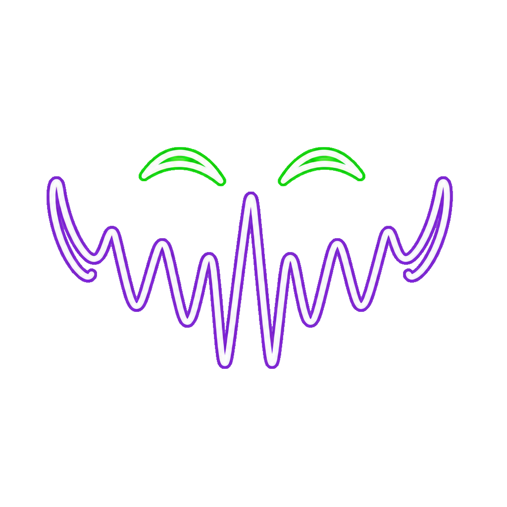

<p align="center">
  
</p>

# NeonMouth

A real-time voice changer for Android. Talk into a microphone and hear your changed voice straight away through headphones or a Bluetooth speaker, so the people around you can hear it too.

Built with .NET MAUI. Audio runs through Android's native AAudio API, and all voice processing is written in C#.

## Features

- **Five voice effects** with an intensity slider:
  - **Natural:** your own voice, unchanged
  - **Witch:** higher pitch with a raspy, nasal edge
  - **Cartoon:** a clean, strongly raised pitch
  - **Monster:** lower pitch with a dark, gritty tone
  - **Robot:** a metallic, ring-modulated voice
- **Microphones:** the phone's own mic, a wired headset mic, a USB mic or wireless-mic receiver, or a Bluetooth headset mic.
- **Outputs:** wired or USB-C headphones, or a Bluetooth speaker or headphones. The phone's own speaker is never used, because it sits right next to the mic and would howl.
- **Automatic device selection.** The app picks a mic and output when it opens and marks them "Auto-selected". It handles devices being plugged in or connected: wired headphones are switched to automatically, and a newly connected Bluetooth speaker gets a "Switch?" prompt.
- **Latency badge.** Shows the estimated delay for the chosen mic, output and effect before you press Start.
- **Feedback protection.** Detects howling (the squeal when a speaker is too close to the mic) and removes it with narrow notch filters, so the rest of your voice stays untouched. It can be switched off.
- **Output gain ceiling** plus a hard limiter that always protects your ears and speakers.
- **Keeps running in the background** and with the screen off, as a foreground service with a Stop button in the notification.

## Requirements

- Android 12 (API 31) or newer. Older devices can install the app but only see an "Android 12 or newer required" message.
- Headphones or a Bluetooth speaker. The phone's own speaker is never used.
- Permissions: microphone (required); nearby devices / Bluetooth (to list and use Bluetooth devices); notifications (for the Stop button while running).

## Latency

What you hear always lags slightly behind what you say. How much depends on the setup:

| Setup | Typical delay |
|---|---|
| Phone mic → wired or USB-C headphones | Lowest: roughly 15–40 ms, depending on the phone and effect |
| Bluetooth headset mic → the same headset | Higher: the Bluetooth call link adds its own delay |
| Any mic → Bluetooth speaker | Highest: roughly 150–250 ms more, from the Bluetooth link and the speaker |

- Witch, Cartoon and Monster add 10–15 ms for pitch shifting; Natural and Robot add almost none.
- With a Bluetooth speaker you hear your own voice come back as a single delayed copy. Most of that delay happens in the Bluetooth link and the speaker, and no app can remove it.
- The badge shows an estimate from typical figures, not a measurement of your devices.

## Limitations

- **Android only.** The iOS build is a placeholder that shows "not supported".
- **A Bluetooth mic only works with the same headset or with wired output.** Android keeps just one Bluetooth audio device active, so for example Pixel Buds mic → JBL speaker isn't possible. The app blocks that combination and explains why. Any non-Bluetooth mic works with a Bluetooth speaker.
- **Bluetooth mics have call quality and fade on held notes.** A Bluetooth mic runs over the headset's phone-call link, so the sound quality is lower than the phone's mic. The headset's own noise suppression treats steady sounds as noise and fades long held notes and singing. This happens inside the headset and the app can't turn it off. Talking works well; for singing, use the phone's mic.
- **Bluetooth speakers that aren't "active" need a tap.** When wired headphones take over, Android makes a connected Bluetooth speaker inactive, and apps can't switch it back. Such a speaker is listed as "(not active)"; choosing it opens Android's settings so you can reactivate it.
- **Feedback protection has limits.** It catches howling, but not the room echo you get with the phone mic close to a loud speaker. Keep the speaker away from the phone and the volume sensible. Bluetooth call-link mics occasionally cause a false, barely audible notch.
- **Slight crackle is possible with a Bluetooth speaker** on some setups: the output buffer stops growing at a cap to keep the delay down.
- **The effects are "decent, not studio".** The pitch shifter is tuned for low delay, not maximum fidelity.

## Privacy

Audio is processed live on the device only. Nothing is recorded, stored or sent over the network. The app explains how it uses the microphone before first use.

## Building

Requires the .NET 10 SDK with the MAUI Android workload (`dotnet workload install maui-android`) and JDK 17.

```
dotnet build NeonMouth -f net10.0-android
```

To install on a connected device with USB debugging:

```
dotnet build NeonMouth -t:Install -f net10.0-android
```

GitHub Actions (`.github/workflows/build.yml`) builds a signed debug APK on every push to `main` and on manual runs.

## Project layout

```
NeonMouth/
  Audio/                    platform contract, latency estimate
  Audio/Dsp/                effects, pitch shifter, howling detector, limiter (platform-independent)
  Platforms/Android/Audio/  AAudio engine, device handling, foreground service
  ViewModels/, MainPage.xaml
docs/Requirements.md        full specification
```

## License

MIT. See [LICENSE.txt](LICENSE.txt).
